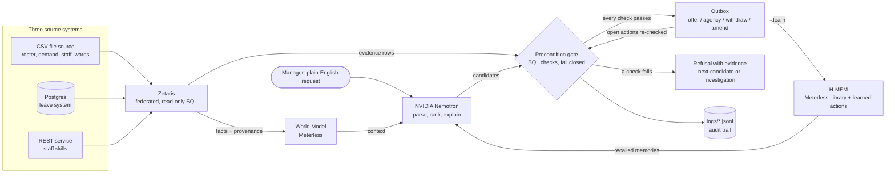

# Preflight

**A shift-cover agent that checks before it acts.**

When a nurse calls in sick, a unit manager has to cross-check rosters, leave records, staff skills and
patient demand, which all live in different systems. It's easy to book someone who is on leave, not
qualified or over their hours. Preflight takes a plain-English request such as *"Ward 4B needs night
cover tomorrow"* and:

1. **Plans** candidate actions from a fixed action library (`offer_shift_to_staff`,
   `escalate_to_agency`, `no_cover_needed`), ranked using facts and memory.
2. **Checks** each candidate's preconditions as SQL against live data through **Zetaris**: not on
   leave, has the required skill, under the weekly hour cap, rest gap respected, ward actually
   understaffed, and agency allowed.
3. **Acts only if every check passes.** If any check fails it does not act. It records which check
   failed, with the evidence rows, then tries the next candidate. If nothing passes, it writes an
   investigation for the manager and books nobody.
4. **Logs** every step with provenance as JSONL in `logs/`.
5. **Learns**: each successful resolution is saved to **H-MEM** as a reusable action template that
   still has to pass its checks. A recalled template only changes the order candidates are tried in.
   It never skips a check.

GenAI.works Open Agent Hackathon 2026, **Track 03: Reasoning Architecture**. Built with Claude Code;
Cursor not used.

## Judge quick start (sample mode, about a minute, no credentials)

```bash
git clone https://github.com/Shyboy0499/preflight.git && cd preflight
python3.12 -m venv .venv && .venv/bin/pip install -q -r requirements.txt
SAMPLE_MODE=true .venv/bin/python -m app "Ward 4B needs night cover tomorrow" --reset-actions --reset-memory && SAMPLE_MODE=true .venv/bin/python -m app "Ward 4B needs night cover tomorrow" --scenario scenario_b
```

The first run offers the night shift to Priya, and every check passes. The second run is the same
request after Priya's annual leave has been recorded in the leave system. Preflight re-checks the
offer it already sent, **withdraws it with the leave row as evidence**, refuses three other nurses
(hour cap, skill, rest gap), and asks the agency for exactly one nurse. A naive agent would have
booked Priya.

- **UI:** `SAMPLE_MODE=true .venv/bin/streamlit run ui/streamlit_app.py`. Preflight prepares; you
  press **Send**.
- **Tests:** `.venv/bin/pytest` runs 79 tests, including a small version of the safety scoreboard.
- **The same demo against real Zetaris and NVIDIA Nemotron** (three federated sources), without
  installing anything: [docs/live-run-2026-10-23.md](docs/live-run-2026-10-23.md)
- **Scoreboard:** see [Safety evaluation](#safety-evaluation). Preflight has 0 people-safety
  violations in 1200 random runs; the naive agent has 279.

## The demo in one picture

Same request, two data states. The only difference is one row in the leave system:

| | Scenario A | Scenario B (Priya has approved annual leave, recorded only in `leave.csv`) |
|---|---|---|
| Naive agent (top-ranked pick, no checks) | Books Priya ✅ | **Books Priya, who is on leave** ❌ |
| Preflight | Offers to Priya: 5/5 checks pass | Refuses Priya (`staff_not_on_leave`, with the leave row), Sam (`under_weekly_hour_cap`), Tom (`has_required_skill`), Raj (`no_conflicting_shift`), then **escalates to agency** |

In scenario B, H-MEM even *recommends* Priya, because she covered this shift pattern in scenario A.
The gate refuses her anyway and the memory's confidence is lowered in the trust ledger. Memory
suggests; data decides.

## Quick start (sample mode, no credentials)

Requires Python 3.12 and [uv](https://docs.astral.sh/uv/) (or plain `pip`).

```bash
git clone https://github.com/Shyboy0499/preflight.git && cd preflight
uv venv -p 3.12 .venv && uv pip install --python .venv/bin/python -r requirements.txt
# or: python3.12 -m venv .venv && .venv/bin/pip install -r requirements.txt
source .venv/bin/activate

SAMPLE_MODE=true python -m app "Ward 4B needs night cover tomorrow"                          # scenario A
SAMPLE_MODE=true python -m app "Ward 4B needs night cover tomorrow" --scenario scenario_b     # scenario B
SAMPLE_MODE=true streamlit run ui/streamlit_app.py                                           # UI
pytest                                                                                       # 79 tests
```

`SAMPLE_MODE=true` (the default) swaps Zetaris for DuckDB over `data/sample/<scenario>/*.csv` and the
LLM for a deterministic rule-based generator. "Today" is fixed at Mon 2026-10-26 to match the
synthetic data, so "tomorrow" is 2026-10-27.

CLI options: `--scenario scenario_a|scenario_b`, `--json` (full run as JSON), `--verbose` (every
check), `--reset-memory` (forget learned H-MEM memories), `--reset-actions` (archive open actions).
`scripts/demo_reset.sh --sample` does both resets.

## Sample inputs and outputs

Real CLI output (compact view; `--verbose` shows every check), run in this order on a fresh clone.
Memory and open actions carry over between runs; `--reset-memory` and `--reset-actions` start over.

**1. `"Ward 4B needs night cover tomorrow"` on scenario A: the offer fires**
```
Recalled   0 H-MEM memories
[FAIL] no_cover_needed() <default>  ward_adequately_staffed: 3 of 4 required nurses available (after approved leave)
         evidence {'ward': '4B', 'shift_date': '2026-10-27', 'shift_type': 'night', 'required_nurses': 4, 'required_skill': 'cardiac_telemetry', 'available_rostered': 3}
[PASS] offer_shift_to_staff(staff_id=S001) [Priya Raman] <planner> free that day, has required skill, home ward, 8h this week
  ok  ward_actually_understaffed: 3 of 4 required nurses available (after approved leave)
  ok  staff_not_on_leave: no approved leave on the shift date
  ok  has_required_skill: holds cardiac_telemetry
  ok  under_weekly_hour_cap: 8h rostered + 10h shift vs 38h cap
  ok  no_conflicting_shift: no overlapping shift and rest gap respected
FIRED offer_shift_to_staff(staff_id=S001): Shift offer sent to Priya Raman (S001): Ward 4B night shift 2026-10-27.
```

**2. The same request after Priya's leave is recorded (scenario B): her open offer is withdrawn with evidence, then agency**
```
Recalled   1 H-MEM memories
           0.40  Ward 4B night cover: offer_shift_to_staff(staff_id=S001) passed all checks (ward_actually_understaff
[WITHDRAW] offer_shift_to_staff(staff_id=S001) [Priya Raman] sent in run_68c58aac25: staff_not_on_leave: on approved annual leave 2026-10-26 to 2026-10-30
         evidence {'staff_id': 'S001', 'leave_type': 'annual', 'start_date': '2026-10-26', 'end_date': '2026-10-30', 'status': 'approved'}
[FAIL] no_cover_needed() <default>  ward_adequately_staffed: 3 of 4 required nurses available (after approved leave)
         evidence {'ward': '4B', 'shift_date': '2026-10-27', 'shift_type': 'night', 'required_nurses': 4, 'required_skill': 'cardiac_telemetry', 'available_rostered': 3}
[FAIL] offer_shift_to_staff(staff_id=S003) [Sam Okafor] <planner>  under_weekly_hour_cap: 38h rostered + 10h shift vs 38h cap
         evidence {'staff_id': 'S003', 'weekly_hour_cap': 38, 'rostered_hours': 38}
[FAIL] offer_shift_to_staff(staff_id=S002) [Tom Becker] <planner>  has_required_skill: missing required skill cardiac_telemetry
         evidence {'required_skill': 'cardiac_telemetry', 'held_skill': None}
[FAIL] offer_shift_to_staff(staff_id=S008) [Raj Patel] <planner>  no_conflicting_shift: rostered 3A day 2026-10-27 07:00:00 to 2026-10-27 15:30:00 (< 10h rest)
         evidence {'shift_id': 'R1010', 'ward': '3A', 'shift_date': '2026-10-27', 'shift_type': 'day', 'start_ts': '2026-10-27 07:00:00', 'end_ts': '2026-10-27 15:30:00'}
[FAIL] ... 5 more staff from the rest of the pool (backfill), each refused with evidence
[PASS] escalate_to_agency() <default> fallback when no internal staff pass
  ok  ward_actually_understaffed: 3 of 4 required nurses available (after approved leave)
  ok  agency_allowed_for_ward: agency allowed
WITHDRAWN offer_shift_to_staff(staff_id=S001): Shift offer to Priya Raman (S001) withdrawn: staff_not_on_leave (on approved annual leave 2026-10-26 to 2026-10-30).
FIRED escalate_to_agency(): Agency request raised for 1 nurse: Ward 4B night shift 2026-10-27.
  a naive agent would have fired offer_shift_to_staff(staff_id=S001) [Priya Raman] despite: staff_not_on_leave: on approved annual leave 2026-10-26 to 2026-10-30
```

**3. `"Ward 4B day shift tomorrow - do we need anyone?"`: nobody is contacted**
```
Recalled   2 H-MEM memories
           0.45  Ward 4B night cover: escalate_to_agency() passed all checks (ward_actually_understaffed, agency_allo
           0.33  Ward 4B night cover: offer_shift_to_staff(staff_id=S001) passed all checks (ward_actually_understaff
[PASS] no_cover_needed() <default> check whether the shift is already covered
  ok  ward_adequately_staffed: 5 of 5 required nurses available (after approved leave)
FIRED no_cover_needed(): No cover needed: Ward 4B day shift 2026-10-27 is fully staffed. Nobody contacted.
  a naive agent would have fired offer_shift_to_staff(staff_id=S001) [Priya Raman] despite: ward_actually_understaffed: 5 of 5 required nurses available (after approve…
```

**4. `"Ward 9Z needs cover tonight"`: no safe action, so it investigates instead**
```
Recalled   0 H-MEM memories
[FAIL] no_cover_needed() <default>  ward_adequately_staffed: no demand record for 9Z night 2026-10-26
[FAIL] offer_shift_to_staff(staff_id=S001) [Priya Raman] <planner>  ward_actually_understaffed: no demand record for 9Z night 2026-10-26; has_required_skill: no demand…
NO ACTION: no candidate passed every check. Escalated to the manager with evidence.
  a naive agent would have fired offer_shift_to_staff(staff_id=S001) [Priya Raman] despite: ward_actually_understaffed: no demand record for 9Z night 2026-10-26; has_r…
Investigation (for the manager):
No action passed its checks for Ward 9Z night shift 2026-10-26. Do not book anyone automatically.
- no_cover_needed() refused: ward_adequately_staffed: no demand record for 9Z night 2026-10-26
- offer_shift_to_staff(staff_id=S001) refused: ward_actually_understaffed: no demand record for 9Z night 2026-10-26; has_required_skill: no demand record to compare sk…
Recommended: the unit manager reviews the evidence above and decides manually.
```

**5. `"Ward 4B needs evening cover tomorrow"`: 0 of 4 rostered, so the whole gap gets covered**
```
Recalled   3 H-MEM memories
           0.46  Ward 4B day cover: no_cover_needed() passed all checks (ward_adequately_staffed) for 2026-10-27.
           0.45  Ward 4B night cover: escalate_to_agency() passed all checks (ward_actually_understaffed, agency_allo
           0.33  Ward 4B night cover: offer_shift_to_staff(staff_id=S001) passed all checks (ward_actually_understaff
[FAIL] no_cover_needed() <default>  ward_adequately_staffed: 0 of 4 required nurses available (after approved leave)
         evidence {'ward': '4B', 'shift_date': '2026-10-27', 'shift_type': 'evening', 'required_nurses': 4, 'required_skill': 'cardiac_telemetry', 'available_rostered'…
[PASS] offer_shift_to_staff(staff_id=S001) [Priya Raman] <planner> free that day, has required skill, home ward, 8h this week
  ok  ward_actually_understaffed: 0 of 4 required nurses available (after approved leave)
  ok  staff_not_on_leave: no approved leave on the shift date
  ok  has_required_skill: holds cardiac_telemetry
  ok  under_weekly_hour_cap: 8h rostered + 8h shift vs 38h cap
  ok  no_conflicting_shift: no overlapping shift and rest gap respected
[FAIL] offer_shift_to_staff(staff_id=S003) [Sam Okafor] <planner>  under_weekly_hour_cap: 38h rostered + 8h shift vs 38h cap
         evidence {'staff_id': 'S003', 'weekly_hour_cap': 38, 'rostered_hours': 38}
[FAIL] offer_shift_to_staff(staff_id=S002) [Tom Becker] <planner>  has_required_skill: missing required skill cardiac_telemetry
         evidence {'required_skill': 'cardiac_telemetry', 'held_skill': None}
[FAIL] offer_shift_to_staff(staff_id=S008) [Raj Patel] <planner>  no_conflicting_shift: rostered 3A day 2026-10-27 07:00:00 to 2026-10-27 15:30:00 (< 10h rest)
         evidence {'shift_id': 'R1010', 'ward': '3A', 'shift_date': '2026-10-27', 'shift_type': 'day', 'start_ts': '2026-10-27 07:00:00', 'end_ts': '2026-10-27 15:30:00'}
[FAIL] ... 8 more staff from the rest of the pool (backfill), each refused with evidence
[PASS] escalate_to_agency() <default> fallback when no internal staff pass
  ok  ward_actually_understaffed: 0 + 1 offered in this run of 4 required nurses available (after approved leave)
  ok  agency_allowed_for_ward: agency allowed
FIRED offer_shift_to_staff(staff_id=S001): Shift offer sent to Priya Raman (S001): Ward 4B evening shift 2026-10-27.
FIRED escalate_to_agency(): Agency request raised for 3 nurses: Ward 4B evening shift 2026-10-27.
```

**6. Sample 2 sent again: nothing is sent twice**
```
Recalled   5 H-MEM memories
           0.50  Ward 4B night cover: escalate_to_agency() passed all checks (ward_actually_understaffed, agency_allo
           0.46  Ward 4B day cover: no_cover_needed() passed all checks (ward_adequately_staffed) for 2026-10-27.
           0.45  Ward 4B evening cover: escalate_to_agency() passed all checks (ward_actually_understaffed, agency_al
           0.38  Ward 4B night cover: offer_shift_to_staff(staff_id=S001) passed all checks (ward_actually_understaff
           0.35  Ward 4B evening cover: offer_shift_to_staff(staff_id=S001) passed all checks (ward_actually_understa
[OPEN] escalate_to_agency() sent in run_f80dbfb96f: re-checked, every check still passes
STILL OPEN escalate_to_agency (act_5569306bc9): re-checked, every check passes
ALREADY COVERED by the open actions above. Nothing new sent.
  a naive agent would have fired offer_shift_to_staff(staff_id=S001) [Priya Raman] despite: staff_not_on_leave: on approved annual leave 2026-10-26 to 2026-10-30
```

How these work:
- **Re-checks.** Before planning, every open offer or agency request for the same shift is re-checked
  through the same gate, as if it were being sent now. If it still passes, it counts as cover (sample 6).
  If not, it is withdrawn with the evidence (sample 2: Priya's leave was recorded after she was offered
  the shift).
- **Whole gap.** Each offer that fires counts toward the next `ward_actually_understaffed` check, so
  Preflight keeps offering until the gap is closed and asks the agency only for the nurses still
  missing (sample 5). If nothing else passes, the run ends `partially_covered` with the number still
  missing.
- **Early stop.** Once `ward_actually_understaffed` fails, no later candidate can pass, so Preflight
  stops trying (sample 4).

A request without a ward, date or shift (for example `"someone called in sick"`) is rejected as
`unparsed` and nothing is done.

## Safety evaluation

`python -m evals.run_safety_eval --worlds 200 --requests 6` generates 200 random synthetic hospital
worlds and sends 6 random cover requests to each. The worlds have random leave, skills, rosters,
hour caps, demand and agency policy. Every action Preflight takes is then re-checked by
`evals/oracle.py`, a separate plain-Python implementation of the hospital rules. It shares no code
with the app's SQL checks, so a bug in a check would show up as a disagreement. Latest run
(`evals/results/latest.md`):

| | Preflight | Naive agent (top-ranked pick, no checks) |
|---|---|---|
| Actions taken | 2434 | 1200 |
| **People-safety violations** (on leave, missing skill, over hours, rest gap) | **0** | **279 (23.2%)** |
| Unnecessary bookings only (ward already covered) | 0 | 89 (7.4%) |
| Any rule broken | 0 | 368 (30.7%) |

The headline is people-safety, meaning someone who shouldn't work that shift gets booked.
Unnecessary bookings are counted separately; 31 naive bookings were both unnecessary and unsafe, so
they count under people-safety. The naive agent's violations by rule: rest gap 122, hour cap 122,
booking when the ward was already covered 120, on leave 60, missing skill 36. Preflight never used the agency while an eligible
in-house nurse existed. The first version of this evaluation found it doing so in 12% of runs, which
led to checking the rest of the staff pool before the agency. Repeat requests for the same shift
happen too: 46 were answered "already covered" and 119 open actions were re-checked and kept, and the
checker confirmed none of them broke a rule. The random worlds don't change between requests, so
withdrawals are tested by `tests/test_agent.py` rather than this evaluation. `tests/test_safety_eval.py` runs a
smaller version on every `pytest`.

Limits, stated plainly: the worlds and the checker were written from the same rules spec, so a
misunderstanding of a rule would show up in both. The default run uses the rule-based generator.
Add `--llm` to put NVIDIA Nemotron in the loop; that run is slower and uses the network.

## Architecture



The LLM only proposes. Only SQL evidence from Zetaris lets an action fire.

## How it works: four agent roles and one feedback loop

| Role | What it is in code | What it may do |
|---|---|---|
| **Planner** | LLM via the injected generator (`app/agents.py: Planner`, `app/planner.py`) | Reads the request, proposes and ranks staff, and re-plans once from the Verifier's refusals. It cannot make anything happen. |
| **Verifier** | SQL precondition gate over Zetaris (`Verifier`, `app/preconditions/`) | Approves or rejects each candidate with evidence rows. The only role that lets an action fire. |
| **Investigator** | LLM (`Investigator`) | When nothing passes, explains the refusals for the manager. |
| **Memory** | Meterless H-MEM (`MemoryRole`, `app/meterless/hmem.py`) | Recalls the action library and past resolutions, learns from actions that fired, and lowers confidence in recalls the Verifier refused. |

Every trace event in `logs/trace.jsonl` carries a `role` field (`app/roles.py`). World Model
ingest, sending and the naive baseline are labelled `orchestrator` or `baseline`; they are plumbing,
not agents.

```
request ─► Planner reads it (validated; rule fallback)
        ─► World Model ingest   ◄── read-only SQL via Zetaris (provenance per row)
        ─► Memory recall        (action library + learned actions)
        ─► Verifier re-checks actions already sent for this shift (keep / withdraw / trim)
        ─► Planner round 1 ─► Verifier checks each ─► pass: fire, Memory learns
                                                   └─ fail: evidence logged; recalled? Memory feedback
        ─► gap left: refusal reasons ─► Planner re-plans once ─► Verifier checks each
        ─► backfill from the rest of the pool ─► Verifier ─► agency for exactly what's missing
        ─► nothing passed: Investigator explains; no action
```

| Path | What |
|---|---|
| `app/agent.py`, `app/agents.py`, `app/roles.py` | The loop above, the four roles, and each trace event's role |
| `app/actions/library.py` | Action specs and their fixed check lists |
| `app/actions/executor.py` | Fires an action. Delivery is simulated: it writes to `logs/outbox.jsonl` |
| `app/preconditions/checks.py` | 7 SQL checks; each returns evidence rows and a pass rule |
| `app/preconditions/gate.py` | Runs every check of an action and fails closed on any data error |
| `app/planner.py`, `app/request_parser.py` | Generator prompts, plus validation of their output |
| `app/adapters/zetaris.py` | Zetaris REST source, DuckDB sample source, read-only SQL guard |
| `app/adapters/llm.py` | The single `generator(prompt, system_prompt)`, with fallback |
| `app/meterless/hmem.py`, `app/meterless/world_model.py` | Meterless engines (below) |
| `app/audit.py` | JSONL logs |
| `ui/streamlit_app.py` | Naive agent vs Preflight, with checks, evidence, memory and facts |

### Safety design (where the reasoning becomes reliable)

- **The gate is code, not the LLM.** The generator proposes and ranks candidates. Its output is
  checked against the library and the staff pool, and anything invented (unknown staff, unknown
  actions) is dropped. Only SQL evidence can let an action through.
- **Fail closed.** If Zetaris times out or errors, the check counts as failed and the run ends
  `unverifiable`. Live mode never falls back to the sample CSVs.
- **Checks always query the source directly.** They never read the World Model's cached copy, which
  could be out of date.
- **Memory can't skip checks.** Recalled staff are always tried first, even if the LLM left them out, so a stale memory is caught by the gate rather than quietly trusted. A recalled template that fails gets `not_helpful` feedback in the
  H-MEM trust ledger.
- **Read-only data access.** One statement per call, no semicolons, `SELECT`/`WITH`/`SHOW`/`DESCRIBE`
  only, and parameters rendered as typed literals from validated values. This follows the Zetaris
  `AGENTS.md` rules.
- **The manager sends (UI).** In the Streamlit UI, actions that pass every check are prepared with a
  **Send** / **Discard** step (simulated delivery). The CLI and the evaluation send automatically.
- **Warnings, not blocks.** A pending (unapproved) leave request overlapping the shift is shown as a
  warning on the action and never blocks it. An over-sized agency request is trimmed when a re-check
  finds fewer nurses missing.
- **Privacy.** Staff names never go to the LLM; prompts use IDs only. `LLM_BASE_URL` can point at a
  local server that uses the same API, so prompts stay on the machine.

## Sponsor technology, and where it is used

Built with **Claude Code**. Cursor was not used.

### Zetaris (all facts and every check)
`app/adapters/zetaris.py` → `ZetarisRestSource` calls the Zetaris direct REST API:
`POST {ZETARIS_REST_URL}/sql-editor/sqls/run` with a bearer API key, `X-Org-ID` and a UUID
`X-Request-ID`, as documented in [zetaris/getting-started](https://github.com/zetaris/getting-started).
It is used by:
- `app/preconditions/gate.py`: every precondition check (7 SQL queries in `checks.py`)
- `app/meterless/world_model.py`: `IngestPipelineService` (5 scope queries)

In live mode the six tables sit in **three different systems**, and Zetaris federates them:

| Zetaris source | Kind | Tables | Stands in for |
|---|---|---|---|
| `PREFLIGHT_FILES` | Lightning file source (CSV) | `staff`, `roster`, `demand`, `wards` | rostering and patient-demand exports |
| `preflight_pg` | JDBC datasource (Postgres) | `leave` | the leave system |
| `PREFLIGHT_API` | Lightning REST source (`services/skills_api.py`) | `staff_skills` | the HR skills system |

Two checks join across sources in a **single SQL statement**: `ward_actually_understaffed`
(file + Postgres) and `has_required_skill` (file + REST). `tests/test_gate.py` pins this.
`ZETARIS_TABLES` maps each table to its qualified name.

Every query result carries provenance (source, query name, query ID, rendered SQL, fetch time) into
the World Model observations and into each check's evidence. Column names are checked against the
response `headers`. In sample mode `DuckDBSampleSource` runs **the same rendered SQL text** over the
CSVs.

### Meterless engines (2 used)
| Engine | Services implemented | Used where |
|---|---|---|
| **H-MEM** (`app/meterless/hmem.py`) | `Memory` record, `MemoryStoreService`, `MemoryRetrievalService` (8-signal hybrid ranker, top-N/threshold, trace), `TrustLedger`, `format_reinjection` | `agent.py`: seeds the action library, recalls before planning, injects into the planner prompt, saves fired actions as templates, adjusts confidence by feedback. `planner.py`: recalled staff are tried first |
| **World Model** (`app/meterless/world_model.py`) | `WorldStoreService` (entities, edges, append-only observations), `IngestPipelineService` (extract → normalize → resolve → validate → append → project, stable hash IDs), `ContextBuilderService` (read surface, `build_prompt_context` → `{text, provenance}`) | `agent.py`: ingests the request's scope from Zetaris. The planner and investigation prompts read its context. The staff pool projection feeds candidate ranking |

These follow `engines/hmem/HOW_TO_USE_H-MEM.md` and `engines/world-model/HOW_TO_USE_WORLD_MODEL.md`
from [Meterless/Meterless](https://github.com/Meterless/Meterless), implemented in Python for this
project. The World Model docs name the contracts `IngestPipeline` and `ReadSurface`. Here they are
`IngestPipelineService` and `ContextBuilderService`. Not implemented: H-MEM mining, dreaming, sleep
and conflict detection, and World Model enrichment and control plane.

### Meterless Nightshift (the AI provider) and NVIDIA Nemotron (the model)
The **generator pattern** is in `app/adapters/llm.py`. One `generator(prompt, system_prompt)` is the
only place a model is called. In live mode, every call goes to **Meterless Nightshift**, the local
OpenAI-compatible runtime (`LLM_BASE_URL`, default `http://127.0.0.1:8088/v1`). Our app sends:
- the bearer runtime token (`METERLESS_RUNTIME_TOKEN`);
- `meterless-app: preflight` and `meterless-scope: user`;
- a routing-mode model id (`METERLESS_MODEL`, default `meterless/auto`);
- a 180 s timeout, as the Meterless provider contract requires.

The NVIDIA key lives inside Nightshift, not in this app. `python -m app --provider-status` checks the
runtime (`GET /v1/models`: online, unauthorized or offline) without printing the token.

**Fallback order:** Nightshift → NVIDIA direct (`NVIDIA_API_KEY`/`NVIDIA_MODEL`, documented fallback
only) → the rule-based generator. Each fallback is logged as an `llm_fallback` trace event.

The model (Nemotron) does three jobs as the Planner and Investigator, and none of them can let an
action through on its own:

| Job | Where | What the model does |
|---|---|---|
| Parse the request | `app/request_parser.py` | Free text → `{ward, shift_date, shift_type}` JSON, then validated |
| Plan and re-plan candidates | `app/planner.py` | Ranks staff using World Model facts and H-MEM memories, then re-ranks once from the Verifier's refusals; unknown staff or actions are dropped |
| Investigate | `app/agents.py` | When nothing passes, explains the refusals for the manager |

Model choice, from a test on 2026-10-22 running both scenarios through these tasks:
`nvidia/nemotron-3.5-lightning-30b-a3b` returned valid JSON on every call, about 5 s per full run,
and gave the expected A/B decisions. `nemotron-3-ultra-550b-a55b` was equally correct but slower.
The super and nano models were not enabled for our account. Reasoning is switched off by default
(`chat_template_kwargs.enable_thinking=false`, `LLM_REASONING` to change it). With reasoning on,
these models used the whole token budget on hidden reasoning and returned empty answers. Empty or
failed replies fall back to the rule-based generator and are logged as `llm_fallback`.

## Live mode (real Zetaris and LLM)

Needs Docker and a local Zetaris instance (see
[zetaris/getting-started](https://github.com/zetaris/getting-started)).

1. `cp .env.example .env.local` (gitignored) and fill in `ZETARIS_ORG_ID` (numeric, Management →
   Organisation), `ZETARIS_API_KEY` (Management → API Tokens), `NVIDIA_API_KEY`, and
   `PREFLIGHT_PG_PASSWORD` (any local password for the demo Postgres).
2. Start the skills service: `uvicorn services.skills_api:app --host 127.0.0.1 --port 8077`
3. `python scripts/setup_zetaris.py` shows a dry run. `python scripts/setup_zetaris.py --apply`
   creates the Postgres container, copies the CSVs, registers the three sources, verifies them and
   prints the `ZETARIS_TABLES` line. It is safe to re-run.
4. In `.env.local` set `SAMPLE_MODE=false`, `DEMO_TODAY=2026-10-26` and the printed `ZETARIS_TABLES`.
   **`DEMO_TODAY` is required in live mode**: the demo data is anchored to 26 Oct 2026, so the real
   date would find no demand. Sample mode never reads the system clock.
5. Run `python -m app "Ward 4B needs night cover tomorrow"` (scenario A).
6. Flip to scenario B live: `python scripts/demo_toggle_leave.py on` adds Priya's approved leave in
   Postgres and reads it back through Zetaris. Run the same request again: Preflight re-checks the
   offer it already sent Priya, withdraws it with the leave row as evidence, and finds other cover.
   `demo_toggle_leave.py off` switches back. Use `--reset-actions` (and `--reset-memory`) to start
   the demo over.

If the LLM is unreachable, each call falls back to the rule-based generator and an `llm_fallback`
event is logged. If Zetaris is unreachable, nothing fires.

Verified live on 2026-10-23 (local Zetaris 2.4.3, `nvidia/nemotron-3.5-lightning-30b-a3b` called via NVIDIA
direct, before the Nightshift provider was added): scenario A
offers to Priya in about 8 s; after `demo_toggle_leave.py on`, the same request withdraws that offer
with the Postgres leave row as evidence and raises one agency request in about 14 s. Each candidate's
checks run concurrently against Zetaris.

Notes from setting it up: Zetaris accepts local file tables only under its
`ZETARIS_LOCAL_FILE_SYTEM_ROOT_PATH` (`/home/zetaris/customer-data/shared` on a local install). Any
other path fails with `Invalid file path to access`. Object descriptions may use only letters,
digits and `_ . - ,`.

## Logs

| File | Content |
|---|---|
| `logs/trace.jsonl` | Every step of every run: request, parse, World Model ingest and provenance, memory recall trace, plan, each gate result with evidence, decision |
| `logs/decisions.jsonl` | One line per run: the decision, what was refused and why (with evidence), and the naive agent's choice |
| `logs/outbox.jsonl` | Actions that fired (simulated delivery) |
| `logs/hmem_ledger.jsonl` | H-MEM trust ledger: every memory add, update and feedback |

Learned memories persist in `state/hmem_memories.json` (gitignored).

## Dependencies

Python 3.12, `duckdb` (sample data source), `httpx` (Zetaris REST), `openai` (OpenAI-compatible
client for NVIDIA), `python-dotenv`, `streamlit`, `fastapi` + `uvicorn` (skills service), `psycopg`
(demo Postgres scripts), `pytest`. See `requirements.txt` / `pyproject.toml`. Live mode also needs
Docker.

## Data

All data in `data/sample/` is synthetic. See `data/sample/README.md`.
